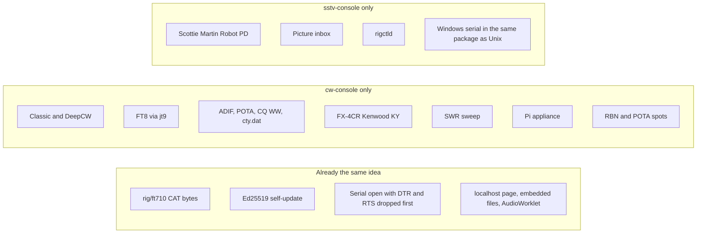
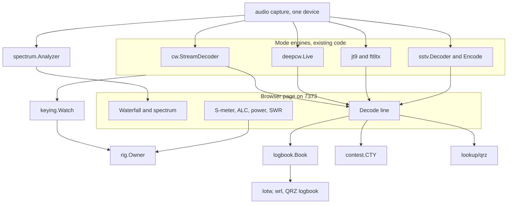
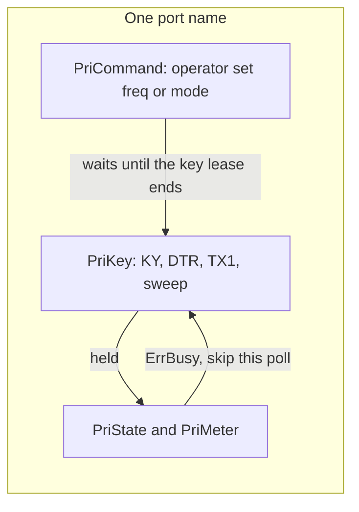
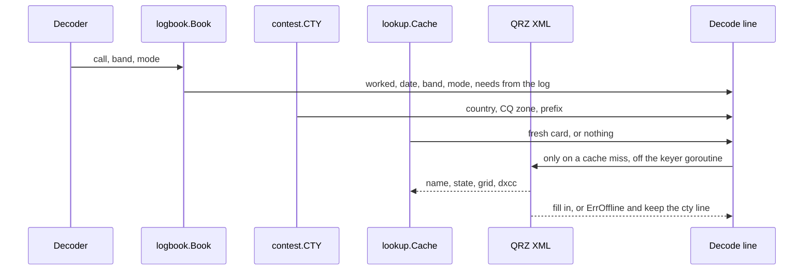

# One console for CW, SSTV and FT8

This is the plan for folding [sstv-console](https://github.com/Jnubbz/sstv-console) into this repository and adding the shared rig, log and lookup layers. The scaffold packages in this change compile and test. They are not called by `cmd/cwmac` or `cmd/cw-decoder`, so keying, CAT, the Pi field box and the self-updater behave exactly as they do on `main`.

sstv-console was cloned read-only at review time and was not modified. Nothing in this change is pushed there.

## Decision: evolve cw-console in place

Keep this repository and the module path `github.com/Jnubbz/cw-console`. Do not open a third repository, and do not import `github.com/Jnubbz/sstv-console` as a Go module.

The sister repo was written to be merged. `rig/ft710/ft710.go` is byte-identical in the two trees. `internal/selfupdate` is the same Ed25519 manifest checker with a different public key, a different release URL and a different User-Agent. A module dependency would freeze two release trains and two signing keys, and every CW fix would have to be republished through SSTV's manifest.

A fresh repository would throw away the update channel existing installs already follow (`internal/selfupdate.ManifestURL` points at `Jnubbz/cw-console` releases), the Pi appliance, the CI matrix and the AGPL history. Installed Mac and Windows builds would not follow a new module path.

sstv-console stays buildable on its own until the unified binary has an SSTV mode that has been used on the air. After that it is archived. Its signing key is not copied into this binary. An SSTV install updates by installing this app once, by hand, and then follows this repo's releases.

The module path stays `github.com/Jnubbz/cw-console` through the migration. Renaming the module, the Mac app or the Pi hostname is a separate decision made after the modes share one process. The page stays on port 7373 (`cmd/cwmac`). SSTV's 7380 goes away when the mode moves here, so the Pi bookmark `http://potapi.local` does not change.

## What each tree is

Both are Go 1.24.7, standard library only, `CGO_ENABLED=0`, AGPL-3.0. Neither tree has per-file copyright headers. `deepcw` has plan9 assembly (AVX2 and NEON), which is not cgo.

### cw-console

| Path | Role |
|---|---|
| `cmd/cwmac` | Mac app and the Pi field box. One `Engine` (`engine.go`). Web UI embedded from `web/index.html` plus fonts and images (`server.go`). Page token `X-CW-Token`. SSE on `/api/events`. Port 7373. `-appliance` turns on the box (Wi-Fi, page password, mDNS, GPIO key, WSJT-X `jt9`). |
| `cmd/cw-decoder` | Windows native window. Its own serial, audio and updater files (`*_windows.go`). Not the same process as `cwmac`. |
| `cmd/cwdecode-file` | Decode a WAV on the command line. |
| `cw/` | Classic decoder (`DecodeCW`, `StreamDecoder`), Morse, `Keyer`, macros, `Waterfall`, WAV. |
| `deepcw/` | ONNX interpreter and `Live` stitcher. Model files under `third_party/deepcw-engine`. |
| `ops/` | Callsign capture (`IsCall`, `FindCalls`, `baseCall`), auto-CQ, ADIF (`Logbook`, `Record`, `ParseADIF`), POTA activation. |
| `contest/` | Embedded `cty.dat`, CQ WW scoring, Cabrillo. |
| `rig/ft710/` | Yaesu CAT bytes, meter calibration, SWR sweep. No I/O. |
| `spots/` | Reverse Beacon Network and POTA spots. |
| `internal/selfupdate`, `internal/appdata`, `internal/signmanifest` | Signed self-update, data directory, manifest signer. |

FT8 on the Pi is not a Go decoder. `cmd/cwmac/ft8.go` shells out to WSJT-X `jt9`. `ft8tx.go` shells out to `ft8tx` and `aplay`, and keys the rig. That stays the FT8 path. A native FT8 decoder is out of scope.

### sstv-console

| Path | Role |
|---|---|
| `sstv/` | Scottie 1/2/DX, Martin 1/2, Robot 36/72, PD120/180/240. `Encode`, `Decoder.Write`, `TestCard`. VIS, off-tune and slant correction, mid-picture join. No PD50/90/160/290. |
| `cmd/sstv-console` | Browser UI (`web/index.html`, `app.js`, `style.css`, `worklet.js`), port 7380, bound to 127.0.0.1. Guard is `X-SSTV-Console: 1`, `Sec-Fetch-Site` and a loopback check (`server.go`). |
| `cmd/sstv-file` | WAV decode and encode. |
| `cmd/sstv-console/rig.go` | One serial port. Yaesu `TX1;` / `TX0;`, or Hamlib `T 1` / `T 0`, or RTS/DTR, or VOX. Band buttons set SSTV frequencies and DATA-U/L. No FX-4CR, no Kenwood KY, no SWR sweep. |
| `cmd/sstv-console/receiver.go` | Picture inbox: `{config}/inbox/*.png` and `received.json`. Unsaved pictures expire after 7 days. Saved copies go to `~/Pictures/SSTV Console`. |
| `cmd/sstv-console/tx.go` | Builds the WAV, keys, plays in the browser, unkeys. A watchdog keeps trying to unkey if the port vanishes. |
| `rig/hamlib` | `rigctld` client, default `127.0.0.1:4532`. Not in cw-console. |
| `internal/serial` | Unix and Windows serial in one package. cw-console still has Unix serial in `cmd/cwmac/serial_unix.go` and Windows serial in `cmd/cw-decoder/serial_windows.go`. |
| `internal/selfupdate` | Same design, key `bGF0snP+…`, manifest on `Jnubbz/sstv-console` releases. |

SSTV has no ADIF log, no contest mode, no QRZ, no cty.dat, and no hardcoded password or API key. The only key in the tree is the public update key.

The SSTV waterfall is an `AnalyserNode` in `web/app.js`. The Go process never sees those bins. Audio in is the same shape as CW: the worklet POSTs float32 to `/api/audio`.

## Where the two trees overlap



| Concern | cw-console | sstv-console | Unified home |
|---|---|---|---|
| Yaesu CAT bytes | `rig/ft710` | identical `rig/ft710` | keep `rig/ft710` |
| Who holds the serial port | several `openCAT` / `openKeyLine` calls | one `catPort` for the life of the connection | `rig.Owner`, one open per name |
| Kenwood / FX-4CR | `catSpecFor` in `cmd/cwmac/rig.go`, `catKeyer` | not supported | the same Kenwood path, behind the owner |
| Hamlib | none | `rig/hamlib` | copy in as `rig/hamlib` in phase 4 |
| Keying | `cw.Keyer` on DTR/RTS, KY over CAT, audio tone on the Pi | `TX1;` / RTS / DTR / VOX, plus an unkey watchdog | `keying` policy plus the existing keyers |
| Dead-man | 5 s, CW queue only (`tx.go`) | TX duration watchdog, not page-disconnect | `keying.Watch` on every transmitter |
| Audio | browser worklet, and ALSA on the Pi | browser worklet | `audio.Input` / `audio.Output`, one open |
| Waterfall | `cw.Waterfall`, separate `ft8WF` | browser AnalyserNode | `spectrum` spans over one FFT |
| Log | `ops.Logbook`, one ADIF file | none | `logbook.Book` over the same file |
| Country | `contest.CTY` for CQ WW only | none | the same file, for every decode |
| Callbook | none | none | `lookup` + `lookup/qrz` |
| Confirmations | none | none | `lotw`, `wrl`, QRZ Logbook |
| Update | this repo's key and URL | the other repo's key and URL | this repo's channel only |
| Config | `Engine.Settings` JSON in the data dir | `Settings` in `SSTV Console/settings.json` | one settings file, SSTV fields added |
| Secrets | Wi-Fi password in the Pi `config.txt` | none | `internal/secrets`, mode 0600, not in git |

## Issues checked in this tree

Each of these was read in the current sources. None of them is changed in this scaffold.

### CAT and keying share a port on the FX-4CR

Real. `catSpecFor` (`cmd/cwmac/rig.go`) puts a Kenwood radio, or a CH340 (`1a86`, the FX-4CR), on the key port at 115200. The FT-710 is the other branch: CAT on the CP2105 `if00` port at 38400, keying on `if01`.

Three openers do not share a file descriptor.

- `catKeyer` (`cmd/cwmac/catkeyer.go`, `newCATKeyer`) holds `openCAT` for the whole transmission and writes `KY`.
- `rigCtl.do` (`cmd/cwmac/rig.go`) takes its own mutex, then opens and closes the same port for every panel command.
- `openPTT` (`cmd/cwmac/ft8tx.go`) opens yet another `catConn` when PTT is `cat`. On the FX-4CR that is `TX1;` / `RX;` on the key port.

`rigCtl.mu` serializes `rigCtl.do` with itself. It does not include the keyer or the PTT connection. Two descriptors on one USB serial port drop bytes. On the FT-710 the key line and the CAT line are different ports, so DTR keying does not collide with CAT. The collision is the FX-4CR, and any future single-port radio.

### FT8 and Tune have no 5 s page dead-man

Real. `deadManAfter` is 5 s (`cmd/cwmac/tx.go`). `txEngine.tickLocked` calls `hub.idleFor()` and stops the CW queue when the page has been gone that long.

`ft8tx.go` does not call `idleFor`. Its idle clock is `ft8Idle` (6 minutes), copied from WSJT-X, and it only stops CQ. `ft8TxWatchdog` (14 s) bounds one FT8 transmission. `tune` runs a tone for `ft8TuneMax` (30 s), or 10 s in the audio and PTT test modes, with no page check. The process-level idle exit in `server.go` only runs when transmit is already off, so it does not stop a Tune tone.

### SWR sweep stop can race the key line

Real. `startSweep` (`cmd/cwmac/rig710.go`) sets `tx.sweeping` and runs `ft710.Sweep` on a goroutine, passing `e.tx.line` as the keyer. `Sweep` (`rig/ft710/sweep.go`) keys, sleeps `KeyDown`, reads `RM6` and `RM5`, then unkeys. The context is checked at the start of a point, not during that sleep.

`stopSweep` only cancels the context. `txEngine.closeLocked` calls `stopSweep` and then `keyer.Close` and `line.Close` without waiting for the goroutine. `unixLine.Key` and `unixLine.Close` (`cmd/cwmac/serial_unix.go`) use the same fd with no mutex. Close drops DTR and RTS and closes the fd while Sweep can still be inside `Key`.

### `TestLiveStitchesAndBreaksLines` fails

Real, and it is not stable. On this Linux amd64 host, `go test ./deepcw/ -run TestLiveStitchesAndBreaksLines -count=1` failed in 21.6 s:

```text
live transcript: ["CQCQ DE KN0BLE K" "KN0BLE DE W1AW 599 BK"]
```

The 4 s gap did produce two lines (`BreakSecs` is 2.5, `stitcher.add` in `deepcw/live.go`). The failure is the missing space in the first over. An earlier run of the same test on this same tree passed and printed `CQ CQ DE KN0BLE K`. So the model can emit the space, and sometimes the stitched transcript loses it.

The test's wait (`deepcw/live_test.go`) treats status `"decoding"` as "caught up", and it does not wait at all while the 15 s prefill is still being pushed. `Live.run` sets that status only after a pass. `TailGuardSecs` (1.5) drops characters in the last part of a window; the next window is supposed to repeat them. A space whose timestamp falls past the cutoff, and which the next window does not repeat before `emittedUntil` moves, disappears. Two inference threads (`Plan{Threads: 2}`) are also a candidate if the matrix code is not deterministic. A later `go test ./... -count=1` on the same host passed, `deepcw` included, so the full suite is not red on every run. This change does not touch `deepcw`. The fix is a later, small one: log the timed characters from each window, run the test at one thread, and wait until the worker is idle before asserting. Do not loosen the expected text to `CQCQ`.

### The ADIF writer does not check callsigns

Real, with a narrower meaning than "the file format requires escapes". `ops.Record` (`ops/adif.go`) writes `<CALL:n>` plus the raw string. ADIF 3.1.4 has no escape syntax; a reader is supposed to honor the length. `ParseADIF` does, so a call containing `<` round-trips through this program.

A reader that scans for the next `<` (and some uploaders do) splits the record. `Record` also does not strip CR, LF or NUL. `Logbook.Add` uppercases and trims the call and does not run `IsCall`. The new `logbook.Format` refuses a value that fails the same callsign test `ops.IsCall` uses, including `W1AW<EOR>`. Free text is length-prefixed after CR, LF and NUL are removed, which is the spec, and a name `A<B` round-trips. `ops.Record` is unchanged until phase 1.

### The band table is US-only

Real. Three copies, all Region 2 / US:

- `ops.bands` (`ops/adif.go`), comment "IARU/US". 40 m is 7.0–7.3, 80 m is 3.5–4.0.
- `cwBands` and `ft8Bands` (`cmd/cwmac/rig.go`). CW is the US General segment. FT8 is the WSJT-X Region 2 dial frequencies.
- `ft710.Bands` (`rig/ft710/sweep.go`), comment "FCC part 97". The sweep will not transmit on 60 m. It will tune 7.0–7.3 MHz, which is wider than a Region 1 phone or CW allocation.

There is no Region 1 or Region 3 table. The default stays Region 2, which is what KN0BLE's station and every current user has. A region setting is phase 5, and the sweep must not grow its transmit range as a side effect.

### The default Pi password is hardcoded

Real. `defaultBoxConfig` and `loadBoxConfig` in `cmd/cwmac/appliance.go` use Wi-Fi name `POTA-Pi` and password `cwdecoder73`. `isDefault` compares against that string, and the page warns. The password is written to `CWDATA/config.txt` when the file is missing.

This change does not remove it. Boxes in the field boot from that default until the operator changes it, and the warning depends on the comparison. Phase 5 stops writing a known password on a first boot that has no `config.txt`: generate one, show it once on the console, leave an existing `config.txt` alone. The string will remain in git history either way.

## Target shape

One process. One serial owner. One capture stream. One ADIF file. Modes are engines registered with `decode.Registry`, not separate programs.





On an FT-710 the CAT name and the key name differ, so a meter poll on the CAT port runs during DTR keying. On an FX-4CR both names are the key port, so a poll during KY gets `rig.ErrBusy` and is skipped. That is the rule `rig.MemOwner` enforces now. The serial owner in phase 2 has to pass the same tests.

`rig.Do` is one lease per call. An SWR sweep holds `PriKey` for the whole sweep, not per point, and `Close` waits until the sweep's `defer` has unkeyed before it closes the fd.

## Module layout

Existing code stays where it is. New packages are the shared layer. `cmd/cwmac` does not import them yet.

```text
github.com/Jnubbz/cw-console
  cmd/cwmac/                  Mac and Pi, unchanged behavior
  cmd/cw-decoder/             Windows, unchanged
  cmd/cwdecode-file/
  cw/                         classic decoder, keyer, current waterfall
  deepcw/                     ONNX decoder
  ops/                        current ADIF and callsign tools
  contest/                    cty.dat and CQ WW
  spots/
  rig/owner.go                NEW  port owner. MemOwner is the contract
  rig/ft710/                  Yaesu bytes, meters, sweep. unchanged
  rig/hamlib/                 phase 4, copied from sstv-console
  audio/                      NEW  capture and playback interfaces
  keying/                     NEW  5 s page dead-man
  spectrum/                   NEW  per-mode frequency spans
  logbook/                    NEW  ADIF record, worked, needs
  lookup/                     NEW  cache, offline fallback, prefix card
  lookup/qrz/                 NEW  QRZ XML client, logbook POST bodies
  lotw/                       NEW  tqsl argv, lotwreport.adi request
  wrl/                        NEW  WRL v1 client
  decode/                     NEW  mode registry
  sstv/                       phase 4, copied from sstv-console
  internal/secrets/           NEW  0600 JSON, gitignored
  internal/selfupdate/        this repo's key and URL, unchanged
  internal/appdata/
```

Phase 4 copies `sstv/` and `rig/hamlib/` in. It does not add a `replace` directive pointing at a checkout of the other repo.

## Reuse map

| Existing file | What moves, and when |
|---|---|
| `rig/ft710/ft710.go` | Stays. `SetFreqA`, `SetMode`, `ParseState`, `MeterRaw`, `SWR`, `Watts`, `ALC` are the dialect the owner sends. Identical file in sstv-console, so either copy is fine. |
| `rig/ft710/sweep.go` | Stays as the sweep planner. Phase 2 runs it under a `PriKey` lease and waits for it on stop. |
| `cmd/cwmac/rig.go` `catSpecFor`, `rigCtl.do` | Phase 2. The bytes stay. The open/close per command goes through `rig.Owner`. |
| `cmd/cwmac/cat_unix.go`, `serial_unix.go` | Phase 2, folded into one serial `Port` with the Windows code from `cmd/cw-decoder/serial_windows.go` and sstv-console `internal/serial`. Both already drop DTR and RTS on open. |
| `cmd/cwmac/catkeyer.go` | Phase 2. `catKeyer` holds `PriKey` on the Kenwood port for as long as KY is outstanding (`kyAhead` is 3 s). |
| `cmd/cwmac/ft8tx.go` `openPTT`, `catPTT`, `tune` | Phase 2. One PTT lease. `tune` calls `keying.Watch`. |
| `cmd/cwmac/tx.go` | Phase 2. `tickLocked` calls `keying.Watch` instead of the local constant. The 5 s value does not change. |
| `cmd/cwmac/audiokeyer.go`, `cw/keyer.go` | Stay. They implement keying. The owner is who holds the line they toggle. |
| `cmd/cwmac/rig710.go` | Phase 2 for the lease. Phase 2 also adds the live meters on the rig sheet. |
| `sstv-console/cmd/sstv-console/rig.go` | Phase 4. `catPort`, `hamRadio` and `lineSetter` become methods on the owner. The Yaesu model table (`yaesuModels`) moves with it. |
| `sstv-console/rig/hamlib` | Phase 4, copied to `rig/hamlib`. A rigctld address is a port name, so two features cannot open two clients. |
| `cw/decoder.go`, `deepcw/live.go` | Stay. Registered as `cw.classic` and `cw.deep`. |
| `cmd/cwmac/ft8.go`, `ft8seq.go`, `ft8tx.go` | Stay the FT8 engine. Registered as `ft8.wsjtx`. |
| `sstv-console/sstv/` | Phase 4, copied to `sstv/`. Registered as `sstv`. |
| `ops/calls.go` | Stays the callsign test until phase 1, then `logbook.ValidCall` is the one copy. The regex in `logbook` matches `ops.IsCall` today, including the `5NN` rejection. |
| `ops/adif.go` | Phase 1. `Record` delegates to `logbook.Format`. The file name stays `cw-decoder-log.adi`. POTA's per-park file stays. |
| `contest/cty.go`, `contest/cty.dat` | Stay the parser. Phase 1 fetches a newer file into the data directory, which `contestCTY` in `cmd/cwmac/contest.go` already prefers over the embedded copy. |
| `cmd/cwmac/contest.go` | Stays CQ WW. The decode card uses the same `CTY` for every mode, not only when contest mode is on. |
| `cw/waterfall.go`, `cmd/cwmac/ft8wf.go` | Phase 3. Replaced by one analyzer. Spans in `spectrum` match today's ranges so the canvas width can stay 256 for FT8. |
| `sstv-console` `web/app.js` AnalyserNode | Phase 4. The page draws the Go bins. The browser FFT is the fallback only if capture is not running. |
| `cmd/cwmac/web/index.html` | Gains the decode card, the meter strip and an SSTV mode. It stays one file until it hurts. |
| `sstv-console` `receiver.go`, `photos.go` | Phase 4. Inbox and the reply-photo library, beside the log. Pictures are not ADIF. |
| `internal/selfupdate` | Unchanged. SSTV's public key is not added. |
| `cmd/cwmac/appliance.go` | Unchanged until the password phase. `-appliance` keeps working at every phase. |

## Decode card

When any mode produces a callsign, the line under the decode shows four things, in this order, and it shows them from local data first:

1. Country and CQ zone from cty.dat. Offline, immediate.
2. Worked before, and if so the latest contact's date, band and mode.
3. Needs: new DXCC, new band, new mode, new state. A first contact with an entity is "new DXCC" only, not also a new band and a new mode. A new state is independent (WAS). An unknown entity is not called a new DXCC.
4. Name, state, grid and the ARRL DXCC number from QRZ, filled in when the lookup returns. A subscription notice from QRZ is shown as QRZ sent it. No subscription still leaves items 1–3 on screen.

Call matching uses the base call, longest slash-separated piece, which is what `ops.baseCall` and `logbook.BaseCall` do. `W1AW/7` is the same station as `W1AW`.

Entity matching uses whichever identifier the log actually has. cty.dat does not carry ARRL entity numbers (the embedded file's version token is `VER20200405`, see below). QRZ and LoTW do. `logbook.Assess` treats a DXCC number match and a cty prefix match as the same entity, so an offline log that only has prefixes does not light up "new DXCC" for a US call the operator has already worked. If neither number nor prefix is known, `NewDXCC` stays false.

State comes from QRZ's `state` field, or from `STATE` on an earlier QSO. cty.dat cannot answer it. Until the lookup returns, the state need is omitted rather than guessed.



The lookup is not allowed to run on the keyer goroutine or the sweep goroutine. A slow QRZ must not delay a dit.

### cty.dat refresh

`contest/cty_test.go` requires `Builtin().Version == "20200405"`. The token is `=VER20200405` in `contest/cty.dat`. That file is April 2020. New entities and prefix moves since then are wrong in the embedded copy.

`Engine.contestCTY` already opens `cty.dat` from the data directory and uses it when `ParseCTY` succeeds, otherwise it falls back to the embedded file and says so. The missing piece is the download.

Phase 1 fetches the current `cty.dat` from [country-files.com](https://www.country-files.com) (AD1C, the file the package comment already names). The fetch is checked with `ParseCTY` and rejected unless `Version` parses and is newer than `20200405`. The previous file is kept as `cty.dat.bak`. A failed download leaves the current file in place. The embedded copy is updated in its own commit when someone wants the offline default to move, and that commit updates the test's expected version on purpose. The app does not need a network connection to resolve a prefix.

### QRZ XML

Spec 1.34, `https://www.qrz.com/docs/xml/current_spec.html`. Service `https://xmldata.qrz.com/xml/current/`.

Login posts `username`, `password` and `agent`. The agent used here is `CWConsole/1`. The response `<Session><Key>` is the session. Later calls post `s` and `callsign`. The spec allows GET. `lookup/qrz.Client` uses POST so the password is not put in a URL. A response with no `<Key>` is a dead session (`qrz.ErrSession`); the client logs in once more and retries the call once. `Count` is how many lookups this user has done in the current day. The cache exists so a busy band does not burn that.

Fields the card uses: `call`, `fname`, `name`, `state`, `country`, `dxcc`, `grid`, `county`, `cqzone`, `ituzone`. A non-subscriber gets a `<Message>` and a thinner `<Callsign>`. That is still a successful lookup. "callsign not found" with a live session is `lookup.ErrNotFound` and is not cached. A timeout or a refused connection with an old card returns the old card and `lookup.ErrOffline`.

Cache TTL is 30 days in memory now, and phase 1 writes it next to the log. The session key is stored in the secrets file (`qrz.session_key`) so a restart does not log in again. It is dropped when QRZ rejects it.

The QRZ password and the logbook key are different credentials. XML login is not the logbook API.

## Waterfall

One FFT on the capture stream. Each mode picks a `spectrum.Span`. The spans in the scaffold match the displays that exist today:

| Mode | Span | Why |
|---|---|---|
| CW | 300–1200 Hz, 200 columns | The sidetone window `cw.Waterfall` is already drawn around. The page still shifts it by the pitch. |
| FT8 | 0–3000 Hz, 256 columns | `ft8WF` (`wfCols`, `wfMaxHz`). |
| SSTV | 1100–2400 Hz, 256 columns | 1200 Hz sync, 1500 Hz black, 2300 Hz white (`sstv.FreqSync`, `FreqBlack`, `FreqWhite`). |

`HzAt` and `ColAt` map a click the same way `cw.Waterfall` does: column 0 is `LoHz`, the last column is `HiHz`. Click-to-tune keeps going through the rig owner as a `PriCommand`, one owner, so a click does not open a second CAT port.

Phase 3 replaces the two Go FFTs (and, when SSTV arrives, the browser AnalyserNode) with one analyzer. Until that lands, the old waterfalls stay. The analyzer should be a 4096-point Hann at the capture rate, noise floor from the median the way both current FFTs do it, and a brighter trace for the spectrum line above the history. The history row can be shorter than the FFT; FT8 already collapses two bins per column. Markers: CW passband, the FT8 transmit audio frequency, the three SSTV tone guides. When CAT knows the dial frequency, the axis is RF kHz as well as audio Hz. Color stays the existing dark blue, and the green field theme when POTA mode is on.

Do not run `cw.Waterfall` and `ft8WF` on the same buffer once the shared analyzer is in. They disagree on FFT size (CW grows the length until about 6 Hz bins; FT8 is 2048 at 12 kHz) and on the floor tracker, which is why the same signal looks different in the two modes today.

## Live meters and the CAT budget

`rig/ft710` already decodes the transmit meters, and the calibration comments cite Hamlib's `ft710.h`:

| Command | Meter | Function |
|---|---|---|
| `RM4;` | ALC | `ALC`, 0–100 % of the raw 0–255 |
| `RM5;` | PO | `Watts`, via `poCal` |
| `RM6;` | SWR | `SWR`, via `swrCal` |

The FT-710 CAT manual (Yaesu FT-710 CAT Operation Reference, ENG 2306-C) lists `RM` parameter 1 as S on the main band, 3 as COMP, 4 as ALC, 5 as PO, 6 as SWR, 7 as IDD, 8 as VDD. The same manual lists a separate `SM` command. `RM1;` uses the parser `MeterRaw` already has. `SM0;` does not. Phase 2 reads S as `RM1;` on the bench with the radio, and only adds `SM0;` if a firmware answers `RM1` with a stuck value. No S-unit curve is invented here. The first UI can show the raw 0–255 and, once a cal is taken the way `swrCal` was, an S-unit beside it.

A working FT-710 logger notes that `RM4`, `RM5` and `RM6` read zero while receiving. The UI shows S on receive, and PO, ALC and SWR only while the rig is keyed. Zeros on receive are not drawn as a 1:1 match.

The radio answers one command at a time. At 38400 8N1 the line time of a short exchange is a few milliseconds, so the limit is the radio's turnaround, not the baud rate. The budget below is a design limit, not a measurement from a radio on this bench. Confirm it on the FT-710 in phase 2 and write the number that actually works into the poller.

- One exchange in flight per port. The owner is what makes that true.
- Minimum gap 50 ms between the end of one answer and the next write.
- Receive: `RM1;` at 200 ms. The nine `StateQueries` (`FA` `FB` `MD0` `FT` `CF000` `CF001` `PC` `RG0` `AG0`) at 1 Hz, and not at all if a `PriCommand` is waiting.
- Transmit, FT-710, key port separate from CAT: replace the S poll with one of `RM5`, `RM4`, `RM6`, rotating, one command per 200 ms. No nine-command state burst while keyed.
- Transmit, FX-4CR, one port: `PriKey` is held for the whole KY lease (`kyAhead` is 3 s of text in `catkeyer.go`). Meter and state return `ErrBusy`. Between words, if the keyer has nothing staged, one poll is allowed. During FT8, the `TX1;` / `RX;` writes take `PriKey` for the write only, then release, so a meter can run while the carrier is up. The poll never shares the fd with KY.
- SWR sweep holds `PriKey` on the key port and `PriCommand` on the CAT port for the whole sweep. The live poller does not interleave with `RM6`/`RM5` inside `Sweep`. Stop waits until the sweep goroutine has finished its unkey `defer` before `unixLine.Close`.

The poller skips a reading rather than queueing it. A queue of skipped polls is how a burst of CAT lands in the middle of the next KY command.

## External services

All four are called by this process, never by the browser. The page on the Pi is reachable on the LAN. A key in the SSE state or in the JavaScript would be a leaked key. WRL sends no CORS headers, so a browser call would fail closed anyway. QRZ and LoTW would not.

### QRZ Logbook

`https://www.qrz.com/docs/logbook/QRZLogbookAPI.html`, checked 2026-11-17. Endpoint `https://logbook.qrz.com/api`. HTTP POST, `KEY` and `ACTION` on every call. The key is the logbook access key from the QRZ site, one key per logbook, not the XML session and not the book id. A logbook is one station callsign. `KN0BLE` and `KN0BLE/P` are different books.

`INSERT`, `DELETE`, `STATUS` and `FETCH` are marked as requiring a subscription. `INSERT` takes one ADIF record. `OPTION=REPLACE` overwrites a duplicate, including a confirmed QSO, so the normal path does not send it. `FETCH` should be paged with `MAX` and `AFTERLOGID` (the guide suggests 250). The response is `RESULT`, `REASON`, `LOGID`, `COUNT`, `ADIF`.

`lookup/qrz.InsertBody` and `FetchBody` build those posts. Phase 5 sends `logbook.Format` output on each QSO the operator logs, stores the returned `LOGID`, and pulls `FETCH` for QSOs that were logged on the QRZ website. The local ADIF file remains the copy the decode card reads, so the card works with the network down. QRZ is a replica, not the source of "worked before".

The User-Agent is `CWConsole/1`. QRZ asks for a real product name and will throttle a generic one.

### LoTW

Two different mechanisms, and two different secrets.

Upload is the `tqsl` program, not libtqsllib. cgo stays off. The command-line reference is `https://lotw.arrl.org/lotw-help/cmdline/`, read 2026-11-17. `lotw.SignUploadArgs` returns:

```text
tqsl -d -u -a compliant -x -l "<station location>" file.adi
```

`-x` is batch: status goes to stderr and TQSL exits instead of opening the GUI. `-q` is the other batch switch. `-a compliant` signs QSOs that are not duplicates and not outside the station location's date range. `-a all` would re-sign duplicates. The ARRL page's worked example uses `-a new`, which is not in the option list (`ask`, `abort`, `compliant`, `all`). This package does not send `-a new`.

`-n` is not batch mode. It reports a new TQSL version and expiring certificates, then exits without signing, and the page says it should not be combined with other switches.

`-p` puts the certificate passphrase in argv, where `ps` shows it. `SignUploadArgs` does not use it. The certificate used by this app should have no passphrase. If one is set, TQSL would prompt, which batch mode cannot answer; the operator clears the passphrase in TQSL rather than handing it to us.

The last line of stderr is `Final Status: … (code)`. 0 is success. 8 is nothing signed because everything was a duplicate or out of range. 9 is a partial. 11 is no route to LoTW. Phase 5 parses that line and does not treat 8 as a hard failure.

Confirmations are a separate HTTP GET, `https://lotw.arrl.org/lotwuser/lotwreport.adi`. Required parameters are `login`, `password` and `qso_query=1`. `qso_qsl=yes` plus `qso_qslsince` downloads QSL records. `qso_qsl=no` plus `qso_qsorxsince` downloads QSOs LoTW has accepted. `qso_withown=yes` adds the station call. The password has to be a query parameter; that is LoTW's API. `lotw.ReportRequest` builds it. `lotw.RedactURL` is what a log line is allowed to print.

The website password is `lotw.password` in the secrets file. It is not the certificate passphrase, and it is not stored in TQSL's config by this program. Downloaded ADIF updates `LOTW_QSL_RCVD` and the QSL date on the matching local QSO. It does not create contacts that were never in the local log.

### World Radio League

WRL has a public API. It is not an ADIF-only service.

Read on 2026-11-17 from `https://api.worldradioleague.com/v1/llms.txt` (the developer page at `https://worldradioleague.com/developer/` loads that spec). The document says version 1.1.0. A WRL forum post from 2026-08-26 (K4AZE, in the Nexus-logger thread) says the v1 API had been released. Base URL `https://api.worldradioleague.com`.

What it actually exposes:

| Method | Path | Use |
|---|---|---|
| GET | `/v1/me` | Who the key is, the default logbook, the quota. Call this first. |
| GET, POST | `/v1/contacts` | List, and log one contact. An array is rejected with 413. |
| GET, PATCH, DELETE | `/v1/contacts/{id}` | Read, correct, delete. PATCH replaces an activities array in full. |
| POST | `/v1/imports` | Start a bulk ADIF import. Returns an upload URL. |
| GET | `/v1/imports/{id}` | Poll. Terminal states include `complete`, `complete_with_errors`, `failed`, `rejected`, `expired`, `cancelled`. |
| GET, POST | `/v1/logbooks` | List, create. |
| GET, PATCH, DELETE | `/v1/logbooks/{id}` | A logbook that still has contacts cannot be deleted (409). |

Auth is `Authorization: Bearer wrl_live_…` or `X-API-Key`. One key for the whole account. It is shown once and stored hashed on their side. Create it under Integrations, Developer API.

Rules that matter here:

- `programId` is required. The scaffold sends `CWConsole`.
- Field names are camelCase ADIF: `call`, `freq`, `band`, `mode`, `rstSent`, `gridsquare`, `state`, `stationCallsign`, `dxcc`. `frequency`, `callsign` and `power` are rejected as unknown fields.
- `mode` is the specific mode. Send `FT8`, not `MFSK` plus a submode. Send `SSTV` for a picture contact.
- `timestamp` is RFC3339 UTC. A `{qsoDate, timeOn}` object is also accepted.
- `freq` is megahertz. `band` is `20m`. If they disagree, frequency wins and the response carries a warning.
- `logbookId` is optional. Omit it to use the default. If the account has several logbooks and no default, the call returns 422 `LOGBOOK_REQUIRED`. Read `GET /v1/me` and ask.
- POTA and the other activities are `myActivities` and `theirActivities` arrays of `{type, ref, isPrimary}`, up to 7 a side. `MY_SIG` / `SIG` are not accepted on this API. An unknown reference is 422 and the contact is not stored.
- Rate limit: 60 writes/min, 120 reads/min, 5000 writes/day, 20000 reads/day. Honor `Retry-After` on 429.
- Enrichment fills `dxcc` and distance a few seconds after insert, and does not overwrite a value we sent. Country and continent are not in the response; they come from `dxcc`. That enrichment is not the decode card. It is too slow, and it is offline the moment the network is. cty.dat plus the local log are the card. WRL is a replica of the log.
- Bulk import: `POST /v1/imports`, `PUT` the `.adi` (max 10 MB) to the returned URL with no API key, poll `GET /v1/imports/{id}`. One import at a time (409 otherwise). `wrl.UploadADIF` does not send the bearer token, and the test checks that.

ADIF import and export still matter. They are the bulk path on this API, the way to recover a log if the key is revoked, and the way to move a log to a service that does not have an API. The local file remains `cw-decoder-log.adi`.

`wrl.Client` implements the one-contact post and the import start. Phase 5 calls it after a QSO is in the local log, and uses the import when the operator asks to upload the whole file.

### Credentials

`internal/secrets` writes one JSON file, mode 0600, under the app data directory (`internal/appdata`). The path is not inside the repository. `.gitignore` ignores `secrets.json` and `*.secrets.json` anyway.

| Key constant | What it is |
|---|---|
| `qrz.username`, `qrz.password` | QRZ XML login |
| `qrz.session_key` | Cached XML session, dropped when QRZ rejects it |
| `qrz.logbook_key` | QRZ Logbook access key, not the password |
| `lotw.username`, `lotw.password` | LoTW website, for `lotwreport.adi` only |
| `lotw.station` | TQSL station location name. Not a secret, stored with them so the upload has one place to look |
| `wrl.api_key` | Bearer token |

The settings page posts a new value and the response says only whether the key is set (`secrets.File.Has`). The value is not echoed and is not put on the SSE state. Error strings from these packages do not contain the values. `lotw.RedactURL` is the one URL that has a password in it, and it is not logged raw.

On the Pi, the SD card is easy to read. Phase 5 also accepts environment overrides so a box can be configured without writing the secrets into `CWDATA`: `CWCONSOLE_QRZ_USER`, `CWCONSOLE_QRZ_PASS`, `CWCONSOLE_QRZ_LOGBOOK_KEY`, `CWCONSOLE_LOTW_USER`, `CWCONSOLE_LOTW_PASS`, `CWCONSOLE_WRL_KEY`. The environment wins over the file when it is set. The image build does not set them. The Wi-Fi password stays in `config.txt`, which is the existing appliance design, and is not copied into this file.

The TQSL certificate and its station locations stay in TQSL's own configuration. This program does not export them and does not store a certificate passphrase.

`UPDATE_SIGNING_KEY` stays a GitHub Actions secret. It is not a user credential and it does not go in the secrets file.

## Phases

Each phase ships on `main` and is picked up by the existing updater. `-appliance` keeps working. No phase changes keying until the one that says it does, and that one is covered by the owner tests before it is pointed at a radio.

### Phase 0, this change

Plan and scaffold. `go build ./...` builds the new packages. The new tests cover the lease rule, the dead-man, the ADIF rejection, worked/needs, the QRZ POST (against a local test server, password not in the URL), the LoTW argv, the WRL request shape, and the secrets file mode. No radio is opened. No user-visible change.

### Phase 1, log and the decode card

Ship the card on the current CW and FT8 decode lines. Still no change to keying.

- Point `ops.Record` at `logbook.Format`. Add `STATE`, `DXCC` and the cty prefix to new records. Old records still parse.
- Build `logbook.Book` from `cw-decoder-log.adi` at startup.
- Wrap `contest.CTY` as `lookup.Prefixes`. Fetch cty.dat as described above.
- Call `lookup/qrz` off the decoder goroutine. Cache in the data directory.
- Settings fields for the QRZ username and password, stored through `internal/secrets`.
- Fix `TestLiveStitchesAndBreaksLines` by making the wait honest and inspecting timed characters. Do not change the expected text to hide a dropped space. If the space is dropped by the stitcher, fix that and add a regression on the timed characters. If it is dropped by a two-thread race in the matrix code, run the test at one thread and fix the race separately.

The Pi page shows the same card, because it is the same `cmd/cwmac` UI.

### Phase 2, one port owner, dead-man, meters

This is the phase that touches transmit. The behavior an operator should notice is: FX-4CR CAT and keying stop stepping on each other, closing the page stops FT8 and Tune within 5 s the way it already stops CW, an SWR sweep cannot outlive its key line, and the rig sheet shows S on receive and PO, ALC and SWR while keyed.

- Serial `Port` behind `rig.Owner`, Unix and Windows. One open per name. `MemOwner`'s tests are the spec: meter and state get `ErrBusy` during `PriKey`, a command waits, a second port (FT-710 CAT beside the key port) still polls.
- Move `rigCtl.do`, `catKeyer`, `openPTT` and the sweep onto it. Same CAT bytes.
- `keying.Watch` in the FT8 tick and in `tune`, and in the sweep loop. CW's 5 s does not change.
- `closeLocked` waits for the sweep goroutine to finish the unkey `defer` before `line.Close`.
- Meter poller at the budget above. Bench it on an FT-710 and on an FX-4CR before it is the default. If the 200 ms gap is too fast for a radio, slow it down. Do not speed it up to make the UI smoother.
- S as `RM1;`, confirmed on the radio. TX meters only while keyed.

### Phase 3, one waterfall

Replace `cw.Waterfall` and `ft8WF` with one analyzer and the spans in `spectrum`. Keep the FT8 canvas at 256 columns so the current drawing code has a path that does not move every pixel. Add the spectrum line, the RF axis when CAT has a frequency, and the mode markers. Click-to-tune goes through `PriCommand`.

### Phase 4, SSTV in this binary

Copy `sstv/` and `rig/hamlib/` in. Register `sstv`. Add the inbox and the reply photos under the same data directory. SSTV transmit uses the owner and `keying.Watch`, and keeps the unkey watchdog from `cmd/sstv-console/tx.go`. The mode is a switch on the existing page, default CW, so a CW operator who updates does not land in a picture composer. Audio capture stays one device. The SSTV browser AnalyserNode is dropped once the shared bins are on the page.

sstv-console gets a final release whose note points here, then it is archived. Its updater key is not merged.

### Phase 5, replicas, region, Pi password

- After a QSO is in the local log: QRZ `INSERT` (no `REPLACE` unless the operator asks), WRL `POST /v1/contacts` with `myActivities` for the current POTA park, and a tqsl upload of the new records. Failures are a note on the log line, not a lost QSO. The local file is already written.
- Periodic `lotwreport.adi` and QRZ `FETCH`, matched back onto local QSOs.
- Whole-log upload uses WRL's import and tqsl, not a loop of single posts.
- Band region setting, default Region 2. Sweep edges and the band buttons read it. Region 1 does not become the default.
- First boot of a Pi image with no `config.txt` generates a Wi-Fi password instead of writing `cwdecoder73`. An existing file is left alone. `isDefault` keeps working for cards that still have the old password, so the warning does not disappear on those boxes.

### Not in these phases

A native FT8 decoder. Icom CI-V. Renaming the module or the Mac app. Moving the Windows UI off `cmd/cw-decoder` (it gains the rig sheet when the shared owner has a Windows serial port, which is phase 2, but the native window stays). Signing the Windows binary and notarizing the Mac app, which the README already lists separately.

## What this change contains

New packages, all unused by the current programs:

| Package | Contract |
|---|---|
| `rig` | `Owner.Do`. `MemOwner` returns `ErrBusy` for a meter or a state poll during a key lease, waits for an operator command, and does not block a different port. |
| `audio` | `Input` and `Output`. No device is opened. |
| `keying` | `Watch` aborts a busy transmitter after 5 s with no page. |
| `spectrum` | `SpanCW`, `SpanFT8`, `SpanSSTV`, `HzAt`, `ColAt`. No FFT. |
| `logbook` | `Format` rejects a bad call. `Book.Assess` answers worked, new DXCC, new band, new mode, new state. |
| `lookup` | Cache, 30 day TTL, stale card plus `ErrOffline` when the source fails. |
| `lookup/qrz` | XML login and callsign over POST. Logbook `INSERT` and paged `FETCH` bodies. |
| `lotw` | `SignUploadArgs`, `ReportRequest`, `RedactURL`. |
| `wrl` | One-contact JSON, `POST /v1/contacts`, import start, ADIF PUT without the API key. |
| `decode` | Registry. Nothing is registered by `init`. |
| `internal/secrets` | 0600 JSON file. |

`go build ./...` and `go test ./... -count=1` passed on this host after the scaffold was added. The live-decoder test is still the flake recorded above, and this change does not paper over it.
